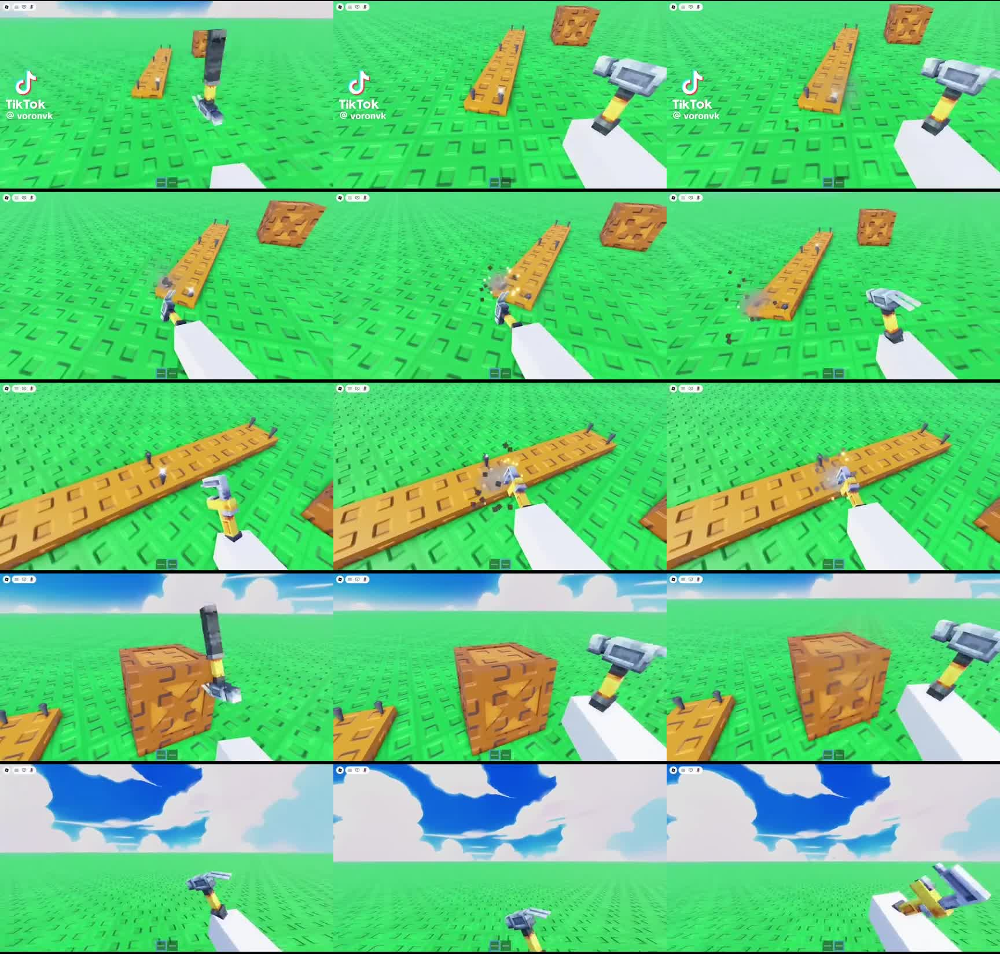
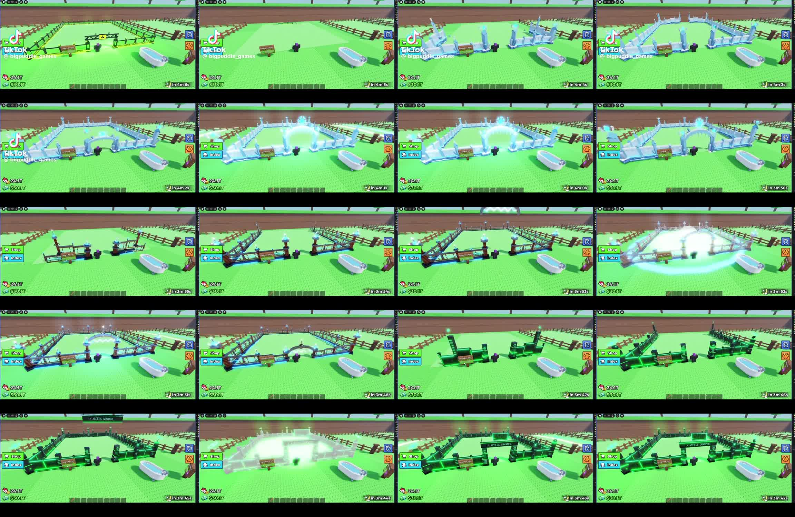

# Design reference clips

Gameplay clips with frame sheets and notes, kept as design references for Roblox projects. Open only the frame sheet a task needs.

| Reference | Clip | Frame sheet |
|---|---|---|
| Hammer viewmodel | [Hammer-Viewmodel.mp4](Hammer-Viewmodel.mp4) | [hammer-viewmodel-frames.jpg](hammer-viewmodel-frames.jpg) |
| Fence build themes | [Fence-Build-Themes.mp4](Fence-Build-Themes.mp4) | [fence-build-frames.jpg](fence-build-frames.jpg) |

## Hammer viewmodel

Clip: [Hammer-Viewmodel.mp4](Hammer-Viewmodel.mp4), 36s, from TikTok @voronvk. Frame sheet is 1 frame per second, from 0:02 to 0:16.

Chunky low-poly claw hammer held in first person on a flat baseplate with a painted anime sky. The player hammers nails into planks, which sink and throw off wood chips, dust and a spark. They also hit a crate and play idle sway and an inspect flip.

What to take from it:
- Swing timing: slow wind-up (about 0.15s, ease-out), fast strike (about 0.06s, ease-in), a short pause on contact, then recovery.
- Hit feedback: at the bottom of the swing, raycast from the camera, then `ParticleEmitter:Emit()` chips and a spark at the hit point, move the nail down a bit and add a very small camera shake.
- Holding feel: put the ViewModel in front of the camera on `RenderStepped`, make it lag a little behind mouse movement, and bob it with walk speed.

## Fence build themes

Clip: [Fence-Build-Themes.mp4](Fence-Build-Themes.mp4), 24s, from TikTok @bigpuddle_games. Frame sheet is 1 frame per second, from 0:00 to 0:19.

A tycoon or steal-style base plot (HUD has Shop, Index, cash and a countdown) whose fence rebuilds in different themes: ice crystal with glowing arches, dark wood with blue lanterns, and neon cyber with an "ACCESS GRANTED" sign over the gate.

Build order, the same for every theme:
1. The old fence disappears.
2. Corner pillars pop up first.
3. Wall segments fill in around the plot.
4. The gate arch goes on last.
5. A white flash covers the plot.

How to build it: give each part a `BuildOrder` attribute. Start each part 4 studs below its spot and invisible. Tween the parts up in order with `Enum.EasingStyle.Back` and a stagger of about 0.04s. Finish with a fading Neon part or Highlight for the flash.

Clips and frames belong to their creators and are kept here only as references. Build original versions; do not reuse their art.
